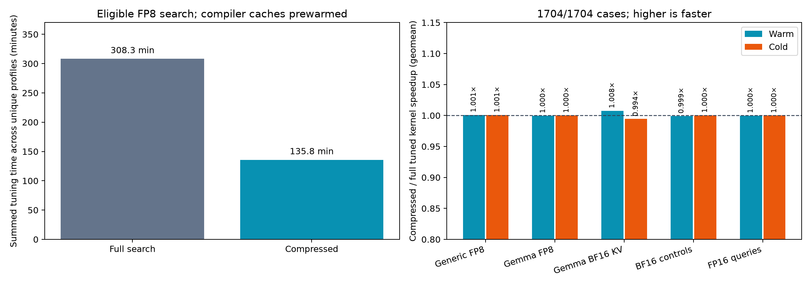

# Compressed segmented-attention autotuning

Complete: 1704/1704 GPU cases, 0 failed cases. Both physical GPUs are Radeon AI PRO R9700 (gfx1201).

The compressed strategy evaluates native4 for every launch geometry, then evaluates the other conversion modes on the best eight geometries and the static incumbent geometry. If a native4 anchor fails validation, its other modes are still evaluated. Normal-only workloads retain their full search. Attention arithmetic, static selection and final promotion thresholds are unchanged by compression.

## Eligible FP8 search cost

| Metric | Full search | Compressed |
|---|---:|---:|
| Unique tuned profiles | 1,154 | 1,154 |
| Valid candidates screened | 80,763 | 45,999 |
| Summed tuning seconds | 18,498.51 | 8,150.61 |
| Median profile seconds | 1.481 | 0.942 |
| P95 profile seconds | 44.923 | 19.256 |
| Maximum profile seconds | 1995.996 | 856.065 |

Measured eligible-FP8 search time fell 55.9%; valid candidate count fell 43.0%. Counting rejected configurations as attempts, eligible FP8 profiles contain 80,850 available candidates and 46,086 attempted compressed candidates (43.0% fewer).

These times sum independent profile work across two GPUs; they are neither wall-clock duration nor one model's startup time. Compiler caches were prewarmed by the preceding study. The search-space reduction applies to eligible FP8 KV workloads; BF16 KV and other normal-only inputs retain their existing candidate pool.
Including all controls, summed tuning time is 20048.19s for full search and 9697.79s for compressed search.

## Tuned kernel performance

| Cohort | Cases | Warm compressed/full | Cold compressed/full | Warm compressed/static | Cold compressed/static | Clear slower vs full |
|---|---:|---:|---:|---:|---:|---:|
| Generic FP8 | 1456 | 1.0010× | 1.0009× | 1.0884× | 1.0397× | 100 |
| Gemma FP8 | 96 | 0.9995× | 1.0001× | 1.1053× | 1.0812× | 1 |
| Gemma BF16 KV | 96 | 1.0076× | 0.9945× | 1.0565× | 1.0344× | 7 |
| BF16 controls | 40 | 0.9991× | 1.0003× | 1.2510× | 1.2068× | 0 |
| FP16 queries | 16 | 0.9998× | 0.9999× | 1.7311× | 1.5746× | 0 |

Ratios above 1 improve performance. A clear change requires at least 2% median paired change and a bootstrap 95% interval excluding parity. These are per-case diagnostic intervals without a multiple-comparison correction.

The full-search winner was present in the compressed measured candidate pool for 1284/1284 freshly tuned profiles; 1088 selected the same stored winner. Candidate availability does not guarantee identical choices under timing noise or identical performance after startup-ceiling configs are applied to narrower actual workloads.

All original apparent compressed-versus-full losses are selected for fresh-input retiming with frozen configs. Confirmation samples do not replace or filter the original aggregate. Representative wins and controls are also retimed.

Confirmations completed: 151. Original clear losses: 108. Reproduced clear losses: 98.

The independent retests show that aggregate parity comes with persistent per-shape losses. The compressed search changes selected configurations even when it measures the eventual full-search winner. In this study, startup-ceiling winners also transfer to narrower runtime shapes, so preserving the candidate pool alone is insufficient to preserve every runtime result.

| Case | D | GQA | Q / KV | Original warm/cold | Retest warm/cold |
|---:|---:|---:|---:|---:|---:|
| 1368 | 512 | 8 | 2 / 33 | 0.897 / 0.755 | 0.890 / 0.756 |
| 708 | 512 | 12 | 1 / 4097 | 0.763 / 1.012 | 0.747 / 1.011 |
| 1369 | 512 | 8 | 2 / 259 | 0.908 / 0.765 | 0.894 / 0.764 |
| 624 | 512 | 5 | 1 / 4097 | 0.813 / 0.920 | 0.813 / 0.911 |
| 648 | 512 | 7 | 1 / 4097 | 0.815 / 0.906 | 0.820 / 0.907 |
| 1472 | 512 | 8 | 1 / 33 | 0.930 / 0.827 | 0.921 / 0.825 |
| 492 | 256 | 10 | 1 / 4097 | 0.829 / 0.985 | 0.839 / 1.062 |
| 540 | 256 | 14 | 1 / 4097 | 0.832 / 1.060 | 0.844 / 1.073 |
| 1473 | 512 | 8 | 1 / 259 | 0.927 / 0.837 | 0.916 / 0.836 |
| 46 | 64 | 4 | 515 / 1091 | 0.841 / 0.887 | 0.839 / 0.888 |
| 1714 | 512 | 12 | 17 / 4117 | 1.076 / 0.858 | 1.074 / 0.857 |
| 145 | 64 | 13 | 5 / 2057 | 0.870 / 0.919 | 0.871 / 0.913 |
| 1498 | 64 | 6 | 17 / 4117 | 0.997 / 0.875 | 0.997 / 0.879 |
| 1163 | 128 | 11 | 1 / 33 | 0.880 / 0.949 | 0.877 / 0.957 |
| 181 | 64 | 16 | 5 / 2057 | 0.884 / 0.929 | 0.876 / 0.933 |
| 577 | 512 | 1 | 5 / 2057 | 0.885 / 1.026 | 0.886 / 1.031 |
| 1164 | 128 | 11 | 1 / 259 | 0.886 / 0.963 | 0.886 / 0.963 |
| 73 | 64 | 7 | 5 / 2057 | 0.888 / 1.012 | 0.900 / 1.007 |
| 1162 | 128 | 11 | 1 / 1 | 0.888 / 0.950 | 0.878 / 0.954 |
| 182 | 64 | 16 | 67 / 1091 | 0.890 / 0.930 | 0.885 / 0.924 |
| 1336 | 512 | 3 | 5 / 259 | 0.902 / 0.976 | 0.900 / 0.968 |
| 912 | 512 | 8 | 1 / 4099 | 1.045 / 0.909 | 1.036 / 0.912 |
| 756 | 512 | 16 | 1 / 4097 | 0.915 / 0.958 | 0.905 / 0.962 |
| 312 | 128 | 11 | 1 / 4097 | 0.923 / 0.939 | 0.920 / 0.941 |
| 1434 | 256 | 2 | 2 / 33 | 0.923 / 0.956 | 0.924 / 0.965 |
| 81 | 64 | 7 | 19 / 2057 | 0.926 / 0.973 | 0.937 / 0.984 |
| 1361 | 512 | 7 | 2 / 33 | 0.934 / 0.970 | 0.935 / 0.966 |
| 1395 | 512 | 12 | 1 / 259 | 0.936 / 0.987 | 0.922 / 0.978 |
| 1379 | 512 | 10 | 1 / 1 | 0.937 / 0.957 | 0.951 / 0.961 |
| 1020 | 64 | 6 | 5 / 33 | 0.989 / 0.938 | 0.982 / 0.937 |

## Validation and artifacts

The main sweep alternates full/compressed tuning order and measures both on identical independent comparison inputs. Timing uses graph-internal GPU events, 11 warm rounds and 41 cold rounds, with a 256 MiB eviction outside the cold interval. Confirmations use 21/101 rounds and another input seed. All outputs must be finite, agree with sampled FP32 attention within 2% relative error, and agree with the static default within 0.5% relative L2.

The typed refactor is applied. Checks on the snapshot used for the main serving comparisons passed: 319 CPU tests and 14 fresh-input GPU smoke cases. [Checks and source hashes](post-types-summary.json). A later host-only fix enables Gemma MTP layers to read the target KV cache without projected K/V. It separately passed 319 CPU checks, 20 GPU tests and repository hooks; all three compiled Triton cache keys and 6,144 existing K/V dispatch checks are unchanged. [MTP fix validation and exact source hashes](../validation/shared-kv-fix/validation.json). The typed refactor also passed strict type, caller-contract and repository checks; 460,800 selector combinations and all 1,284 saved candidate pools match the measured implementation. Its three Triton kernel ASTs are identical, although moving host functions shifted their source lines and required recompilation before serving. The later MTP cache-reader fix preserves those compiled cache keys.

- [Detailed JSON](search-report.json), [CSV measurements](search-measurements.csv), [interactive table](search-report.html)
- [Paired candidate audit](paired-profile-audit.json), [offline replay](cpu-replay-audit.json)
- [Frozen protocol](protocol.json), [confirmation protocol](confirmation-protocol.json)
- [Type equivalence](type-safety-equivalence.json), [work notes](experiment-notes.json)
