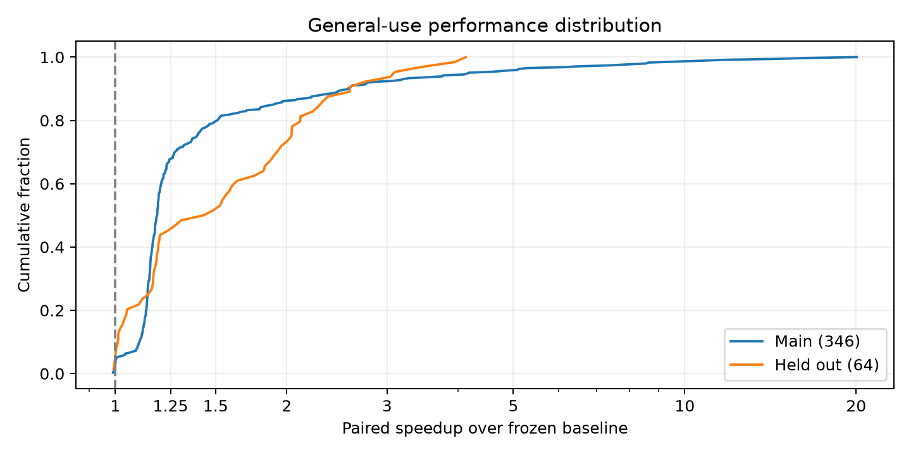
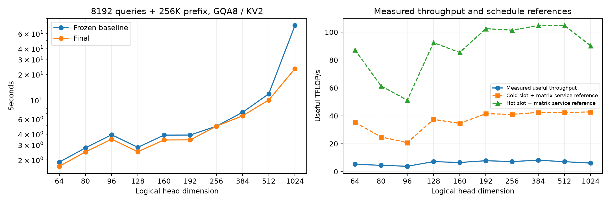

# RDNA4 Octave attention: profiling-guided general-use release

The final implementation is published in `benchmarks/kernels/rdna4_octave`. Its frozen candidate is `22_hybrid_scalar`. All measurements use physical GPU 0, Radeon AI PRO R9700 (`gfx1201`), under the shared GPU lock.

Across **346 paired main configurations**, the geometric-mean speedup is **1.428x**, median **1.184x**. **64 separately specified held-out configurations** give **1.546x** geometric mean. These are synthetic per-layer kernel measurements with equal fixture weighting, not whole-model throughput.

## Coverage and accuracy

- **27 logical head dimensions**, 32 head/RoPE combinations: `[(32, 32), (40, 32), (48, 32), (64, 64), (80, 64), (96, 24), (112, 64), (128, 128), (128, 32), (128, 0), (160, 64), (192, 64), (224, 64), (256, 64), (256, 32), (256, 128), (256, 256), (320, 64), (384, 64), (512, 64), (576, 64), (768, 128), (1024, 128), (1, 0), (7, 3), (63, 1), (65, 64), (127, 63), (255, 128), (511, 129), (960, 0), (1000, 128)]`.
- GQA ratios `[1, 2, 3, 4, 5, 6, 7, 8, 12, 16, 17, 31, 32, 33, 63, 64, 65, 127]`; KV head counts `[1, 2, 3, 4, 8, 16]`. MHA and MQA are included. Other positive integer ratios are accepted by the interface.
- Three wire formats; FP16/BF16; page sizes 16/32; both cache layouts; strided projections; ragged and empty requests; poisoned unused metadata; explicit and automatic splits.
- **2324 attention configurations / 6972 comparisons**, checking every output row of these small fixtures. Maximum relative L2 is **0.139% per token / 0.364% per head**, under the unchanged 2% gate.
- **384 cache-store fixtures**, 369 byte-exact against Torch, maximum reconstruction error **0.050%**, below 1%. All masked/unused slots remain intact. Another 45 timed store fixtures match the frozen baseline's entire cache byte for byte.
- 60 query/metadata graph-transition states, 600 raw/cached V range-transition states, 216 unusual-split checks, plus graph capture and buffer canaries on every main accuracy comparison. Another 120 replay states permute decode rows and request mappings, including the large scalar specialization.
- **13 full-output endpoint fixtures / 106,496 output-token rows**, including 8192 queries over a 256K prefix at D64/128/256/512/1024, all three GQA6 formats at D256, and independent 8192-request decode. Maximum per-head error is **0.496%**. Graphs replay again after the independent reference allocations.

All accuracy comparisons use independent FP32 Torch attention over the **same packed KV**. They do not establish codec loss against original KV, model task accuracy, or production serving behavior.

## General performance

| Suite | Cases | Geometric mean | Median | Minimum | Maximum |
| --- | --- | --- | --- | --- | --- |
| Main attention | 346 | 1.428x | 1.184x | 0.991x | 20.045x |
| Held-out attention | 64 | 1.546x | 1.457x | 0.993x | 4.124x |
| Cache store | 45 | 1.065x | 1.080x | 0.956x | 1.246x |



| Logical D | Main cases | Geometric mean | Minimum |
| --- | --- | --- | --- |
| 64 | 37 | 1.282x | 1.094x |
| 80 | 25 | 1.393x | 1.099x |
| 96 | 25 | 1.381x | 1.094x |
| 128 | 47 | 1.303x | 0.996x |
| 160 | 25 | 1.465x | 1.089x |
| 192 | 37 | 1.364x | 1.035x |
| 256 | 45 | 1.128x | 0.991x |
| 384 | 25 | 1.491x | 1.022x |
| 512 | 37 | 1.443x | 1.072x |
| 576 | 6 | 1.333x | 1.197x |
| 768 | 6 | 2.194x | 1.185x |
| 1024 | 31 | 2.543x | 1.041x |

Timings use preallocated HIP graphs, randomized paired order and median device-event latency (five trials normally, three for the largest endpoints). Compilation, packing and Torch references are excluded. Small performance fixtures check every row; larger fixtures sample rows while checking every head/dimension and the full causal context for each selected row. Full-output validation is reported separately. Baseline kernels **and Python policy** are frozen from the preceding head-dimension release. Source and policy hashes accompany timings.

Unchanged native timing fixtures, 45 store timings and 13 full-output fixtures retain their recorded measurement provenance; generic scalar timing fixtures are remeasured for the final reduction specialization. Final policy refinements lower tiny-MHA split overhead, keep scalar split increases within the fast-merge output range, and retain the packed path for short K3V3 or fragmented MHA cases. Instruction bytes and resource metadata are checked per kernel for inherited matrix, guard, store, merge and legacy work; the final run remeasures 49 generic scalar configurations. A metadata-only check also proves the selected engine and split count unchanged for each inherited attention fixture. All main accuracy/store/graph gates and a fresh 64-case held-out set run with the final policy. Earlier off-grid sets were used for policy and scalar-reduction refinement and remain separate from this final held-out set. See [measurement provenance](stages/22_hybrid_scalar/measurement-provenance.json).

### Maximum prefix endpoints

Every row below uses 8192 query tokens, a 262144-token cached prefix, BF16 K3V4, GQA8 and two KV heads. The final sequence length is 270336. These differ from older GQA6-only endpoints.

| D / RoPE | Stored D | Baseline seconds | Final seconds | Speedup | Useful TFLOP/s |
| --- | --- | --- | --- | --- | --- |
| 64 / 64 | 64 | 1.882 | 1.684 | 1.118x | 5.30 |
| 80 / 64 | 128 | 2.764 | 2.477 | 1.116x | 4.51 |
| 96 / 24 | 192 | 3.936 | 3.494 | 1.127x | 3.84 |
| 128 / 128 | 128 | 2.802 | 2.492 | 1.125x | 7.17 |
| 160 / 64 | 192 | 3.897 | 3.419 | 1.140x | 6.53 |
| 192 / 64 | 192 | 3.906 | 3.428 | 1.139x | 7.82 |
| 256 / 64 | 256 | 4.953 | 4.951 | 1.000x | 7.22 |
| 384 / 64 | 384 | 7.199 | 6.555 | 1.098x | 8.18 |
| 512 / 64 | 512 | 11.840 | 10.025 | 1.181x | 7.13 |
| 1024 / 128 | 1024 | 74.632 | 23.307 | 3.202x | 6.13 |



## What changed and what the profiler shows

The selected changes use aligned vector LDS fragments, local-memory barriers, disjoint request tiles, native gfx12 register permutations, K/V phase reuse for wide heads, D512-specific V padding, parallel merge for small output grids, calibrated metadata-only engine/split selection, and a separate reduction lowering for large narrow-head scalar grids. Query, logit and output range guards recover affected work in FP32. Very small logical heads (D<32) use FP32 directly.

The wide K/V staging change doubles the matrix query rows to 16. The final static audit finds zero private scratch in all 576 compiled generic matrix variants (the sampled D1024 matrix previously used 80 B/thread). Its traced matrix time falls from about 18.2 to 11.5 ms in the targeted 256-query / 4K-prefix sample. Ordering guard checks across adjacent heads cuts the large-batch guard from about 0.21 to 0.057 ms. Parallel split merge reduces the long-MHA merge from about 0.23 to 0.017 ms. These are per-stage profiler samples; the direct final comparisons above determine the overall gains.

Three release gaps were found and fixed: FP16 overflow from finite large values, underflow from tiny V values, and cancellation in the expanded D1 domain. The final overflow/tiny suites pass 36 generic, 27 legacy, and 240 small-value comparisons. Range-triggered FP32 recovery can be slower than the normal matrix path. The baseline did not pass these stress suites.

All stages have kernel traces and resource fields. Most also have sampled decoded ATT. SQ_WAVES is validated against launch geometry. Instruction/memory counters that return zeros on active kernels are rejected. ATT on the small parallel-merge grid timed out; no instruction-level conclusion is drawn from that capture. FP32 recovery kernels may retain private scratch even where the hot WMMA matrix has none. See [profiler limitations](profiler-notes.md), [step decisions](decisions.md), and the final [profile review](stages/22_hybrid_scalar/profiles/review.json).

## Roofline and remaining headroom

Fresh same-device controls measure **611.8 GB/s** large-buffer streaming bandwidth, **1.51 TB/s** hot streaming bandwidth, **180.5 TFLOP/s** FP16 WMMA, and **375.6 TOP/s** INT8 WMMA. Controls validate outputs, including signed INT8. Useful attention operations count QK+PV and exclude decode, transforms, softmax, barriers and merging.

| D | Observed ms | Issued-matrix reference ms | Slot cold reference ms | Slot hot reference ms |
| --- | --- | --- | --- | --- |
| 64 | 1684.1 | 49.5 | 252.7 | 102.3 |
| 80 | 2477.1 | 99.0 | 449.3 | 181.9 |
| 96 | 3493.7 | 148.5 | 645.8 | 261.5 |
| 128 | 2491.8 | 99.0 | 477.4 | 193.3 |
| 160 | 3418.6 | 148.5 | 645.8 | 261.5 |
| 192 | 3427.5 | 148.5 | 645.8 | 261.5 |
| 256 | 4951.2 | 198.0 | 870.5 | 352.5 |
| 384 | 6555.1 | 297.0 | 1263.6 | 511.7 |
| 512 | 10025.4 | 396.0 | 1684.8 | 682.3 |
| 1024 | 23307.0 | 1583.7 | 3341.5 | 1353.2 |

These are optimistic service references, not utilization measurements or promised speedups. The matrix estimate includes padded/masked WMMA work; D256 uses an approximate generic partition estimate. Slot-equivalent bytes count repeated requested slots under the schedule, not measured DRAM transactions. Cross-workgroup cache reuse can reduce external traffic, while transaction granularity and decode loads can increase it. The two bandwidth controls bound different working-set regimes.

There remains substantial architectural headroom. The wide path uses eight KV columns in a native 16-column matrix tile to stay within LDS, wasting some matrix work. ATT identifies remaining LDS/load completion waits. A future iteration can investigate more efficient wide-head tiling, K/V decode exchange, and producer/consumer overlap. Broad packed-word loading, indiscriminate LDS padding and the first doubled-row prototype were tested and rejected where they regressed. No FP8 or codec/codebook precision change is introduced.

## Interface and release scope

```python
from octave_tuned import TunedHipOctave
hip = TunedHipOctave.build(head_dim=128, rope_dim=128)
layout = hip.layout("octave_k3v4")
signs = layout.sign_bits().cuda()
# Cache: uint8 (pages, KV heads, page size, layout.slot_bytes).
# Q/K/V keep logical D. Attention output is FP32.
# Auto scratch: (tokens, query_heads, splits, hip.head_dim + 2).
```

Build, preallocate buffers, and run a warm-up call before graph capture. Default automatic scratch is bounded at 2 GiB; explicit split counts bypass that policy. The selector reads allocation metadata, while kernels read live causal lengths on every replay. Runtime layout/sign metadata requires Torch; kernel builds/execution require HIP; the external vLLM format source is needed only for reference tests. The compatibility single-library constructor remains available.

Supported attention is dense causal paged attention with post-RoPE Q/K and equal logical Q/K/V dimensions. Logical D is 1–1024 when separately padded RoPE/NoPE segments fit 1024; compact layout pads the full head to a power of two. Different geometry caches are not interchangeable. Unequal QK/V MLA, sliding-window/softcap/bias semantics and end-to-end model integration need separate work. Gfx1201 is measured; gfx1200 is a compile target only.

## Public package checks

The promoted builders pass 32 numerical/graph API fixtures and six additional large-grid scalar fixtures, with bit-exact outputs against the frozen candidate. Three standalone runtime fixtures run without the reference checkout imported. The compatibility constructor remains usable. Both native source families compile for gfx1200; hardware execution is validated on gfx1201. The final package test run passes **210 tests**; the CPU-only run passes **189 tests**, with GPU tests skipped.

## Artifacts and reproduction

Run the checkout tests and D256/R64 bring-up harness as described in the [package README](../../README.md). The records below preserve the broad release evaluation from the tuning workspace. [Publication notes](publication.md) explain portability changes and which historical artifacts are included; raw captures, binaries and the full stage-generation workspace are not bundled.

[All timings](performance.csv), [summary and worst cases](summary.json), [final source freeze](stages/22_hybrid_scalar/release-inputs.json), [ISA/resources](stages/22_hybrid_scalar/isa-summary.json), [roof controls](roofline/ceilings.json), [roof assumptions/data](roofline/attention.json), [full-output checks](stages/22_hybrid_scalar/release-full-output.jsonl), [GPU ownership log](gpu-use.jsonl). The superseded Stage 17 run, the earlier off-grid sweep used to find the tiny-MHA policy gap, and rejected experiments are retained separately. Initial store timings with a masked single-token fixture were replaced by the seeded active-slot timing run. The batched full-output reference flattens batch/position axes for the three-dimensional wire dequantizer and cross-checks sampled requests against the streaming oracle.
