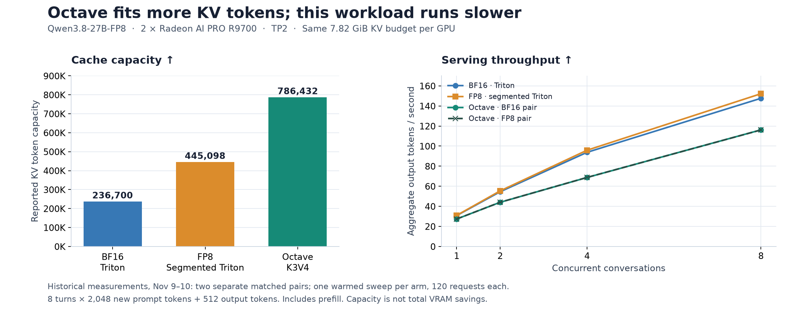

# Dense attention: KV capacity and serving performance

This packet adds previously collected BF16/FP8 comparisons to PR #67844. No new GPU measurements were made for this update. The November 9–10 benchmarks used an earlier development implementation; they are not throughput measurements of the current PR. Current-PR validation is documented in the [parent evidence packet](../README.md).

Both comparisons used Qwen/Qwen3.8-27B-FP8, two Radeon AI PRO R9700 GPUs (gfx1201), TP2, BF16 activations, 65,536 maximum model length, 8,192 batched tokens, 256 maximum sequences, vision enabled, prefix caching, and default FULL_AND_PIECEWISE graphs. Model weights were FP8 in every arm; the table varies the KV cache format and attention backend. Each GPU received exactly 8,393,906,176 bytes (7.817 GiB) of KV cache budget.

The workload is eight conversation turns, approximately 2,048 new synthetic prompt tokens and exactly 512 generated tokens per turn, at 1/2/4/8 concurrent conversations. Actual histories grow from about 2.1K to 20.1K tokens. Each backend received one full untimed primer, then a prefix-cache reset and one measured sweep. The sweep retains prefix cache between concurrency levels. There are 120 measured requests per arm, including the client-marked warmup request, with zero errors, incomplete requests, preemptions, or measured first-use JIT warnings. The BF16 comparison ran Octave then BF16; the FP8 comparison ran FP8 then Octave. These are two separate pairs, not a randomized three-way trial or repeated-run confidence intervals. Generated responses feed subsequent turns, so actual prompt lengths differ slightly.

| KV cache / backend | K+V bytes per token per KV head | Engine-reported KV tokens | Prefix hits | Attention block, tokens |
| --- | ---: | ---: | ---: | ---: |
| BF16 / TRITON_ATTN | 1,024 | 236,700 | 73.0% | 832 |
| FP8 / ROCM_SEGMENTED_ATTN | 512 | 445,098 | 70.6% | 1,568 |
| Octave K3V4 / native RDNA4 HIP | 248 | 786,432 | 66.1% | 3,264 |

The byte counts apply to head dimension 256 and rotary dimension 64. BF16 is `2 × 256 × 2` bytes; FP8 is `2 × 256` bytes, with shared per-tensor scales outside the slot. K3V4 is 32 bytes of rotary K codes, 72 bytes of other K codes, 128 bytes of V codes, 10 bytes of FP16 scales and 6 alignment bytes: 248 total. The PR's actual `OctaveFormat` class was evaluated to confirm all three packed layouts: K3V4 248 B, K3V3 216 B, compact K3V3 196 B. Serving results here cover K3V4 only.

K3V4 uses 75.8% less packed attention storage than BF16 and 51.6% less than FP8. Engine capacity increases are 3.32× and 1.77×, respectively. Hybrid recurrent state, padding, cache groups and allocation granularity prevent slot ratios from directly predicting engine capacity. Engine-reported tokens are not proof of sustained throughput at full capacity or of that many simultaneous maximum-length requests.

The separate GSM8K run used ordinary **TRITON_ATTN FP8**, which reported **446,202** cache tokens under the same budget, compared with 236,700 BF16 and 786,432 Octave. That gives 1.76× Octave/FP8 capacity. [Worker settings and capacity log excerpts](accuracy-capacity-provenance.json) verify this distinction. It must not be substituted for the segmented FP8 backend's throughput measurement.

| Concurrent conversations | BF16 tok/s | Paired Octave tok/s | FP8 segmented tok/s | Paired Octave tok/s |
| ---: | ---: | ---: | ---: | ---: |
| 1 | 30.77 | 27.36 | 30.98 | 27.35 |
| 2 | 54.53 | 44.03 | 55.39 | 44.06 |
| 4 | 93.82 | 68.76 | 95.90 | 68.80 |
| 8 | 147.63 | 116.16 | 152.19 | 116.10 |

Aggregate output throughput is total generated tokens divided by the first request start to last request end at each concurrency. It includes prefill and is not decode-only speed. At eight conversations Octave is 21.3% slower than BF16 and 23.7% slower than segmented FP8. Mean time to first token is 5.45 → 8.77 seconds in the BF16 pair and 5.51 → 8.82 seconds in the FP8 pair. Mean request latency is 27.74 → 35.25 and 26.90 → 35.27 seconds. This synthetic benchmark does not measure task success.

Segmented FP8 enabled startup autotuning. Four distinct tuning shapes were skipped because scratch allocations did not fit; those shapes retained the fallback launch policy. Startup tuning was excluded from measurement. Prefix hit rates and cache block sizes differ, so this is a serving configuration comparison, not an isolated measurement of dequantization cost.

Equal KV allocation does not imply equal total VRAM. Driver snapshots after the BF16 pair were 26.45/26.41 GiB for BF16 versus 28.43/28.39 GiB for Octave (GPU 0/1). The FP8 pair was 27.05/27.00 versus 28.70/28.64 GiB. These snapshots include weights, graph pools, allocator reservations and workspace; they are not peak-memory measurements. The current PR's dense attention can reserve up to 2 GiB of FP32 split workspace per GPU outside the KV budget.

## Evidence and reproduction

- [summary.json](summary.json): audited capacity, full precision aggregate/request metrics, slot sizes and original report checksums.
- `*-requests.json`: every successful request's timing, token counts, conversation ID and turn index, extracted without filtering from the four source reports (480 requests).
- `*-provenance.json`: server commands, both worker inspections, workload configuration, cache-log excerpts and source hashes. Historical software and model revisions are retained here for traceability; they are not installation requirements.
- [accuracy-capacity-provenance.json](accuracy-capacity-provenance.json): independent ordinary Triton BF16/FP8 and Octave capacity evidence.
- [render.py](render.py): regenerate the chart and independently verify all 16 aggregate throughput points from included request records with `uv run --no-project .venv/bin/python render.py` in an environment with matplotlib.
- [collect.py](collect.py): collection/audit script for the original workspace layout. It checked source-report SHA-256 hashes against both archived comparisons and success manifests, every conversation's eight turns, all output lengths, workload equality, and metrics against the archived analysis. It reads the PR's format class to calculate packed sizes without loading GPU libraries.

To repeat the serving workload in a prepared environment, use the per-arm server command and workload JSON embedded in its provenance file. Update local paths, launch that server, run the workload once as an untimed primer, reset prefix cache, then run the measured sweep with `uv run --no-project .venv/bin/python -m guidellm run --config workload.json --disable-console-interactive`. The historical Octave backend name was `ROCM_OCTAVE_RDNA4`; the current PR exposes it through `ROCM_OCTAVE`. The segmented FP8 backend belongs to the development benchmark stack and is not introduced by this PR.

The linked [full GSM8K comparison](../historical/dense-gsm8k.md) remains the accuracy evidence: 1,273/1,319 BF16, 1,275/1,319 ordinary Triton FP8, and 1,275/1,319 Octave. Small score differences do not establish a quality improvement. Current-PR Flash-Next checks are documented separately in the parent packet.
