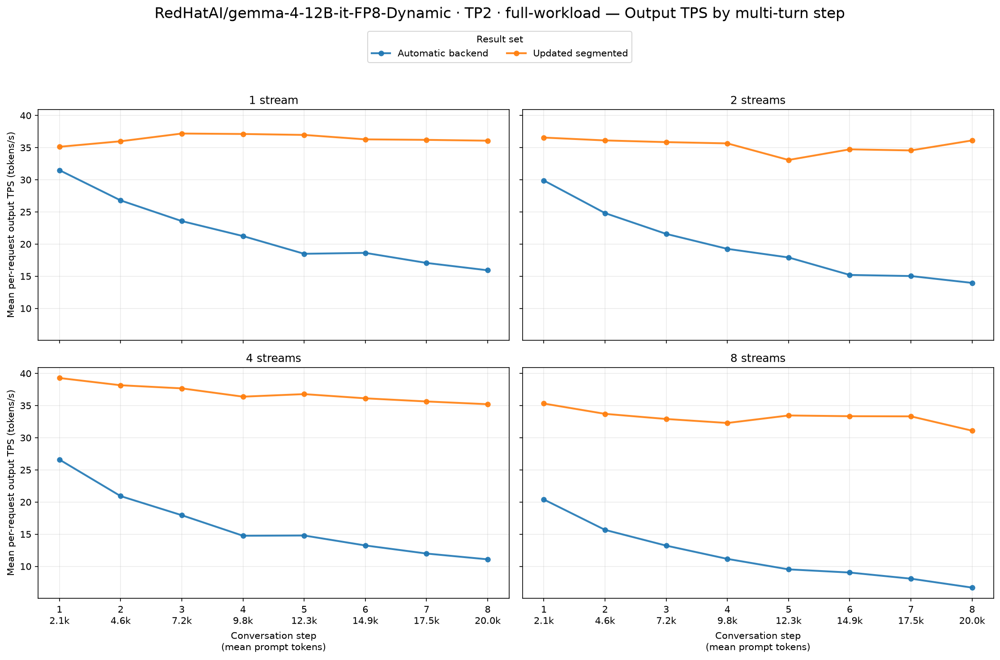
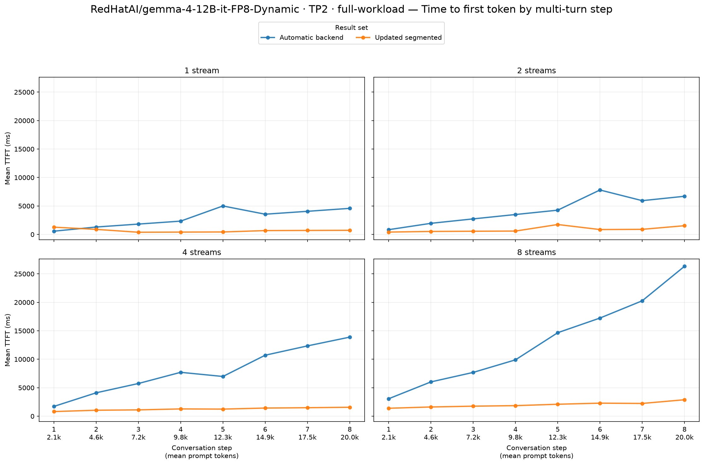
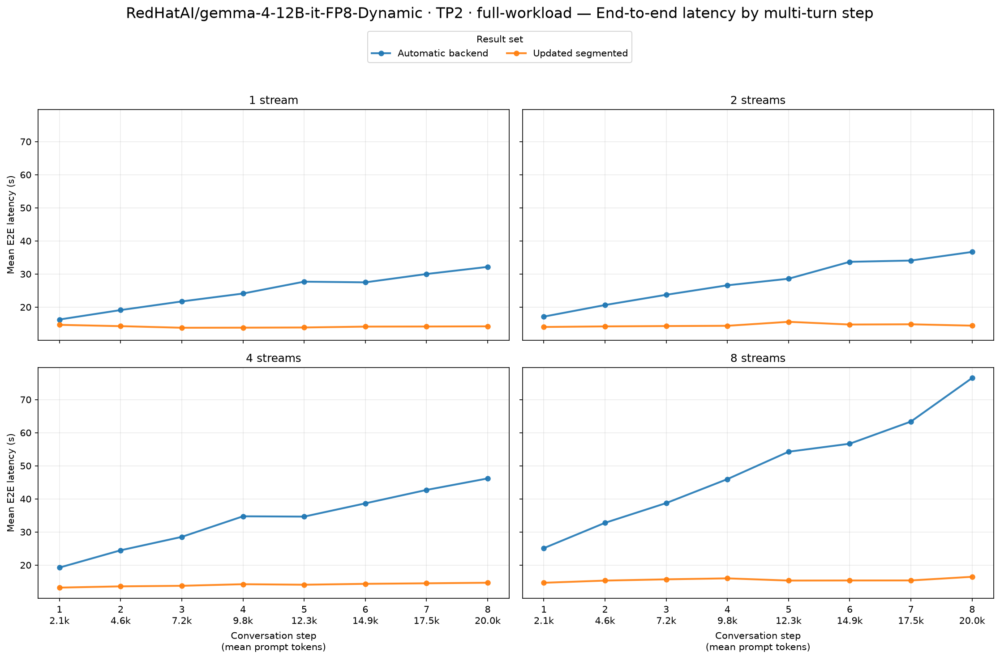

# RedHatAI/gemma-4-12B-it-FP8-Dynamic · TP2 · full-workload

Automatic backend → Updated segmented. These are end-to-end serving results on two Radeon AI PRO R9700 GPUs (gfx1201), with TP2, BF16 activations, FP8 model weights and explicit FP8 KV cache in every arm.

Model revision: `2083adceb2a3df0465e6021e08a7196d21dbbb44`. Workload: eight turns, 2,048 new synthetic prompt tokens and 512 output tokens per turn; streams 1/2/4/8; seed 20260715; prefix caching enabled. 2 fresh server repetitions per arm. The attention backend is the experimental change described by the arm labels.

Segmented startup autotuning: `True`. Main model limits: context 32,768, eight sequences, batched-token limit 8,192, GPU memory utilization 0.90. Backend choice was inspected on both workers; automatic selection uses no attention-backend flag.

Observed baseline backends by rank: `[{'TRITON_ATTN': 48}, {'TRITON_ATTN': 48}]`. Candidate: `[{'ROCM_SEGMENTED_ATTN': 48}, {'ROCM_SEGMENTED_ATTN': 48}]`.

Model, data definition, streams, request limits and seed match. Every repetition contains 8/16/32/64 successful turn requests and no errored or incomplete requests. The table and charts use means over every successful request, including warmup/cooldown, through the skill's summary and plotting helpers. Positive TPS changes and negative TTFT/E2E changes improve performance.

| Streams | Output tok/s, baseline → candidate | Output tok/s change | Mean TTFT (ms), baseline → candidate | Mean TTFT (ms) change | Mean E2E (s), baseline → candidate | Mean E2E (s) change |
|---:|---:|---:|---:|---:|---:|---:|
| 1 | 21.65 → 36.37 | **+68.0%** | 2,903 → 686 | **−76.4%** | 24.82 → 14.09 | **−43.2%** |
| 2 | 19.71 → 35.34 | **+79.3%** | 4,215 → 889 | **−78.9%** | 27.64 → 14.54 | **−47.4%** |
| 4 | 16.42 → 36.91 | **+124.8%** | 7,898 → 1,246 | **−84.2%** | 33.64 → 14.04 | **−58.3%** |
| 8 | 11.72 → 33.19 | **+183.1%** | 13,146 → 2,016 | **−84.7%** | 49.17 → 15.52 | **−68.4%** |

Output tok/s changes range from +68.0% to +183.1% across the four stream counts.
Mean TTFT (ms) changes range from -84.7% to -76.4% across the four stream counts.
Mean E2E (s) changes range from -68.4% to -43.2% across the four stream counts.

Per-repetition means retain every successful request and expose variation between fresh servers:

| Repeat | Streams | TPS, baseline → candidate | TPS change | TTFT ms, baseline → candidate | TTFT change |
|---:|---:|---:|---:|---:|---:|
| 1 | 1 | 21.66 → 35.87 | **+65.6%** | 2,912 → 877 | **-69.9%** |
| 1 | 2 | 19.71 → 34.45 | **+74.8%** | 4,223 → 1,034 | **-75.5%** |
| 1 | 4 | 16.42 → 33.07 | **+101.4%** | 7,909 → 1,244 | **-84.3%** |
| 1 | 8 | 11.72 → 31.42 | **+168.2%** | 13,330 → 2,019 | **-84.9%** |
| 2 | 1 | 21.64 → 36.87 | **+70.4%** | 2,893 → 496 | **-82.9%** |
| 2 | 2 | 19.70 → 36.22 | **+83.9%** | 4,207 → 744 | **-82.3%** |
| 2 | 4 | 16.42 → 40.76 | **+148.2%** | 7,887 → 1,247 | **-84.2%** |
| 2 | 8 | 11.73 → 34.95 | **+197.9%** | 12,961 → 2,013 | **-84.5%** |

Achieved mean concurrency for each repetition:

| Arm | Repeat | Streams | Mean active requests |
|---|---:|---:|---:|
| Automatic backend | 1 | 1 | 1.000 |
| Automatic backend | 1 | 2 | 1.999 |
| Automatic backend | 1 | 4 | 3.999 |
| Automatic backend | 1 | 8 | 7.998 |
| Automatic backend | 2 | 1 | 1.000 |
| Automatic backend | 2 | 2 | 1.999 |
| Automatic backend | 2 | 4 | 3.999 |
| Automatic backend | 2 | 8 | 7.998 |
| Updated segmented | 1 | 1 | 1.000 |
| Updated segmented | 1 | 2 | 1.999 |
| Updated segmented | 1 | 4 | 3.999 |
| Updated segmented | 1 | 8 | 7.997 |
| Updated segmented | 2 | 1 | 1.000 |
| Updated segmented | 2 | 2 | 1.999 |
| Updated segmented | 2 | 4 | 3.999 |
| Updated segmented | 2 | 8 | 7.996 |

Startup and tuning are excluded from serving latency. The main comparison has two server repetitions; short exploratory controls have one. Pooled request means are descriptive and do not establish statistical significance. Prefix cache is reset before each complete GuideLLM sweep; the original workload retains cache state between its stream levels.
Compiler caches persist across repetitions. If present, `logs/segmented-serving-2026-10-16/cache-reuse.json` records the reuse of matching model/backend compiler caches and target-attention tuning tables for MTP startup; existing identity and workload guards still validate cache entries.

Raw reports:

- [Automatic backend, repetition 1](../../../raw/gemma-4-12b-fp8-dynamic/tp2-default-full-decode-rep1/agent-multiturn-benchmarks.json), [server setup](../../../raw/gemma-4-12b-fp8-dynamic/tp2-default-full-decode-rep1/setup.json), [worker inspection](../../../raw/gemma-4-12b-fp8-dynamic/tp2-default-full-decode-rep1/inspection.json)
- [Automatic backend, repetition 2](../../../raw/gemma-4-12b-fp8-dynamic/tp2-default-full-decode-rep2/agent-multiturn-benchmarks.json), [server setup](../../../raw/gemma-4-12b-fp8-dynamic/tp2-default-full-decode-rep2/setup.json), [worker inspection](../../../raw/gemma-4-12b-fp8-dynamic/tp2-default-full-decode-rep2/inspection.json)
- [Updated segmented, repetition 1](../../../raw/gemma-4-12b-fp8-dynamic/tp2-segmented-after-full-decode-rep1/agent-multiturn-benchmarks.json), [server setup](../../../raw/gemma-4-12b-fp8-dynamic/tp2-segmented-after-full-decode-rep1/setup.json), [worker inspection](../../../raw/gemma-4-12b-fp8-dynamic/tp2-segmented-after-full-decode-rep1/inspection.json)
- [Updated segmented, repetition 2](../../../raw/gemma-4-12b-fp8-dynamic/tp2-segmented-after-full-decode-rep2/agent-multiturn-benchmarks.json), [server setup](../../../raw/gemma-4-12b-fp8-dynamic/tp2-segmented-after-full-decode-rep2/setup.json), [worker inspection](../../../raw/gemma-4-12b-fp8-dynamic/tp2-segmented-after-full-decode-rep2/inspection.json)
