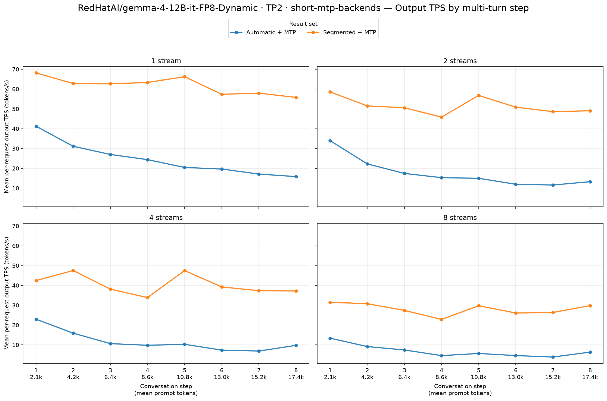
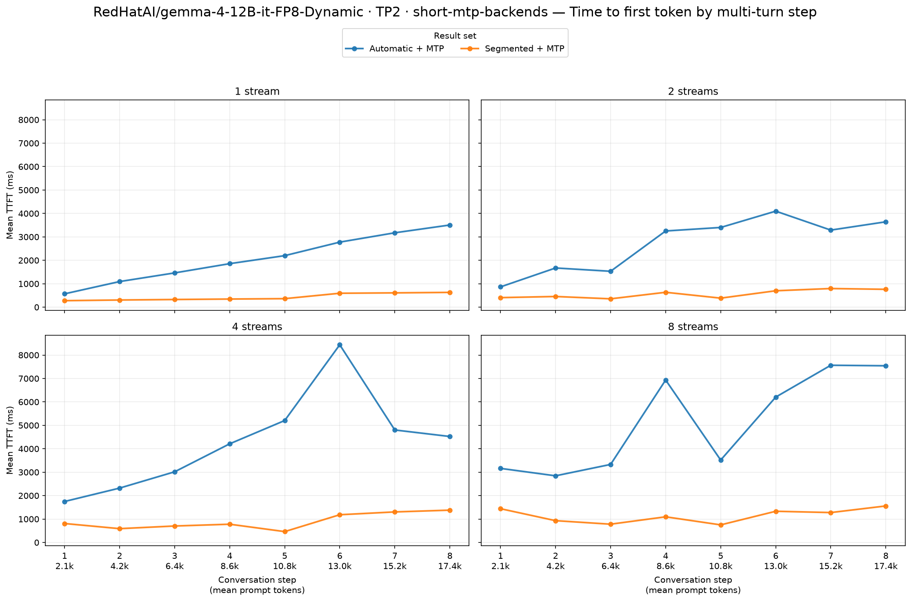
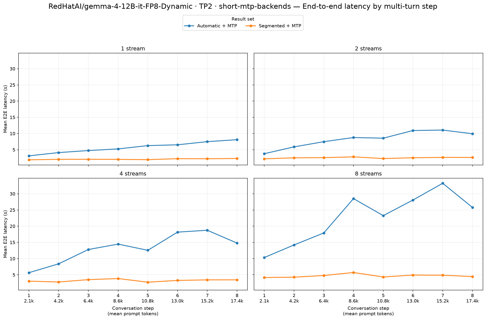

# RedHatAI/gemma-4-12B-it-FP8-Dynamic · TP2 · short-mtp-backends

Automatic + MTP → Segmented + MTP. These are end-to-end serving results on two Radeon AI PRO R9700 GPUs (gfx1201), with TP2, BF16 activations, FP8 model weights and explicit FP8 KV cache in every arm.

Model revision: `2083adceb2a3df0465e6021e08a7196d21dbbb44`. Workload: eight turns, 2,048 new synthetic prompt tokens and 128 output tokens per turn; streams 1/2/4/8; seed 20260715; prefix caching enabled. 1 fresh server repetitions per arm. The attention backend is the experimental change described by the arm labels.

Segmented startup autotuning: `True`. Main model limits: context 32,768, eight sequences, batched-token limit 8,192, GPU memory utilization 0.90. Backend choice was inspected on both workers; automatic selection uses no attention-backend flag.

Observed baseline backends by rank: `[{'TRITON_ATTN': 52}, {'TRITON_ATTN': 52}]`. Candidate: `[{'ROCM_SEGMENTED_ATTN': 52}, {'ROCM_SEGMENTED_ATTN': 52}]`.

Model, data definition, streams, request limits and seed match. Every repetition contains 8/16/32/64 successful turn requests and no errored or incomplete requests. The table and charts use means over every successful request, including warmup/cooldown, through the skill's summary and plotting helpers. Positive TPS changes and negative TTFT/E2E changes improve performance.

| Streams | Output tok/s, baseline → candidate | Output tok/s change | Mean TTFT (ms), baseline → candidate | Mean TTFT (ms) change | Mean E2E (s), baseline → candidate | Mean E2E (s) change |
|---:|---:|---:|---:|---:|---:|---:|
| 1 | 24.59 → 61.77 | **+151.2%** | 2,080 → 432 | **−79.2%** | 5.70 → 2.08 | **−63.5%** |
| 2 | 17.58 → 51.46 | **+192.8%** | 2,720 → 562 | **−79.3%** | 8.29 → 2.51 | **−69.8%** |
| 4 | 11.69 → 40.40 | **+245.6%** | 4,283 → 901 | **−79.0%** | 13.19 → 3.25 | **−75.3%** |
| 8 | 6.87 → 28.05 | **+308.2%** | 5,138 → 1,146 | **−77.7%** | 22.66 → 4.69 | **−79.3%** |

Output tok/s changes range from +151.2% to +308.2% across the four stream counts.
Mean TTFT (ms) changes range from -79.3% to -77.7% across the four stream counts.
Mean E2E (s) changes range from -79.3% to -63.5% across the four stream counts.

Every short condition runs a separate, untimed copy of the complete short workload before measurement. Prefix cache is reset afterward and counters are sampled after a 12-second flush interval. The measured GuideLLM report still includes all of its successful warmup/cooldown requests. Primer reports are retained separately.

MTP cache-reader support and checks: [validation](../../../validation/shared-kv-fix/validation.json), [kernel/dispatch equivalence](../../../validation/shared-kv-fix/math-equivalence.json), [tuning-cache reuse provenance](../../../validation/shared-kv-fix/cache-migration.json). The failed initial MTP startup and the original source snapshots are retained; no measured requests from that failure enter this comparison.

Achieved mean concurrency for each repetition:

| Arm | Repeat | Streams | Mean active requests |
|---|---:|---:|---:|
| Automatic + MTP | 1 | 1 | 1.000 |
| Automatic + MTP | 1 | 2 | 1.994 |
| Automatic + MTP | 1 | 4 | 3.984 |
| Automatic + MTP | 1 | 8 | 7.942 |
| Segmented + MTP | 1 | 1 | 0.999 |
| Segmented + MTP | 1 | 2 | 1.995 |
| Segmented + MTP | 1 | 4 | 3.992 |
| Segmented + MTP | 1 | 8 | 7.864 |

MTP counters are measured by subtracting Prometheus snapshots immediately before and after the measured workload; the initial smoke and any separate primer are excluded. Speculation uses one token and the matching pinned Google assistant checkpoint with its published BF16 weights.

| Arm | Draft tokens | Accepted | Acceptance |
|---|---:|---:|---:|
| Automatic + MTP | 9254 | 6031 | 65.17% |
| Segmented + MTP | 9195 | 6083 | 66.16% |

This short synthetic MTP run measures serving behavior under fixed output lengths. It does not establish acceptance or speedups on natural conversation data. The matching short non-MTP controls provide a same-workload speculation comparison.

Startup and tuning are excluded from serving latency. The main comparison has two server repetitions; short exploratory controls have one. Pooled request means are descriptive and do not establish statistical significance. Prefix cache is reset before each complete GuideLLM sweep; the original workload retains cache state between its stream levels.
Compiler caches persist across repetitions. If present, `logs/segmented-serving-2026-10-16/cache-reuse.json` records the reuse of matching model/backend compiler caches and target-attention tuning tables for MTP startup; existing identity and workload guards still validate cache entries.

Raw reports:

- [Automatic + MTP, repetition 1](../../../raw/gemma-4-12b-fp8-dynamic/tp2-default-short-mtp1-rep1/agent-multiturn-benchmarks.json), [server setup](../../../raw/gemma-4-12b-fp8-dynamic/tp2-default-short-mtp1-rep1/setup.json), [worker inspection](../../../raw/gemma-4-12b-fp8-dynamic/tp2-default-short-mtp1-rep1/inspection.json)
  [Separate untimed primer](../../../raw/gemma-4-12b-fp8-dynamic/tp2-default-short-mtp1-rep1/primer-multiturn-benchmarks.json).
- [Segmented + MTP, repetition 1](../../../raw/gemma-4-12b-fp8-dynamic/tp2-segmented-after-short-mtp1-rep1/agent-multiturn-benchmarks.json), [server setup](../../../raw/gemma-4-12b-fp8-dynamic/tp2-segmented-after-short-mtp1-rep1/setup.json), [worker inspection](../../../raw/gemma-4-12b-fp8-dynamic/tp2-segmented-after-short-mtp1-rep1/inspection.json)
  [Separate untimed primer](../../../raw/gemma-4-12b-fp8-dynamic/tp2-segmented-after-short-mtp1-rep1/primer-multiturn-benchmarks.json).
