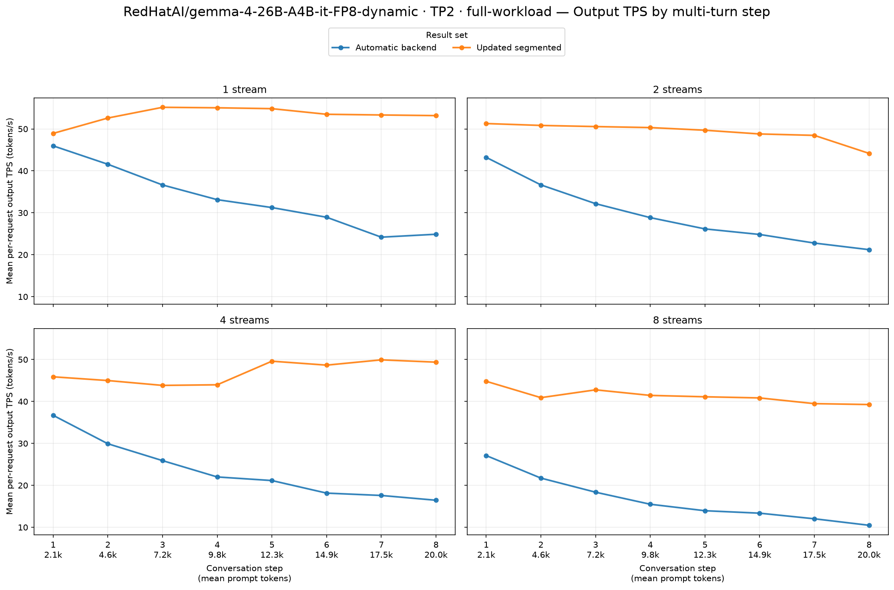
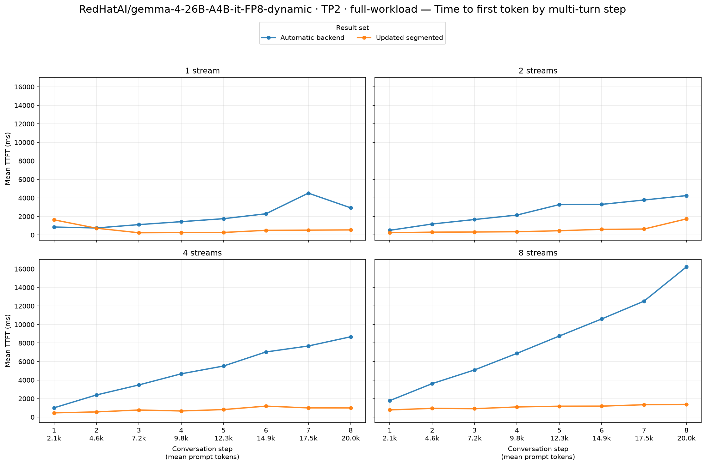
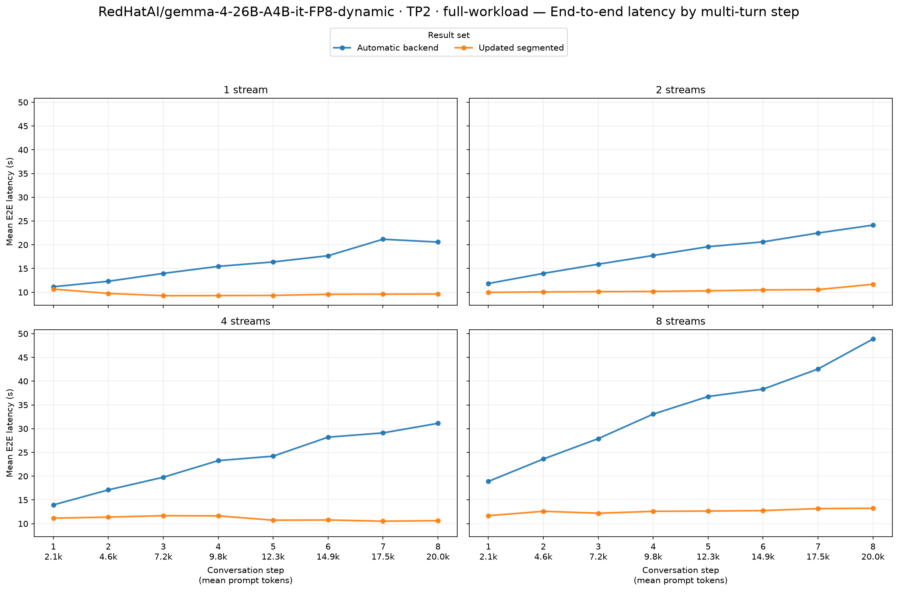

# RedHatAI/gemma-4-26B-A4B-it-FP8-dynamic · TP2 · full-workload

Automatic backend → Updated segmented. These are end-to-end serving results on two Radeon AI PRO R9700 GPUs (gfx1201), with TP2, BF16 activations, FP8 model weights and explicit FP8 KV cache in every arm.

Model revision: `ed35d7abe5d940da41b4ff06eb482feb0be8cb44`. Workload: eight turns, 2,048 new synthetic prompt tokens and 512 output tokens per turn; streams 1/2/4/8; seed 20260715; prefix caching enabled. 2 fresh server repetitions per arm. The attention backend is the experimental change described by the arm labels.

Segmented startup autotuning: `True`. Main model limits: context 32,768, eight sequences, batched-token limit 8,192, GPU memory utilization 0.90. Backend choice was inspected on both workers; automatic selection uses no attention-backend flag.

Observed baseline backends by rank: `[{'TRITON_ATTN': 30}, {'TRITON_ATTN': 30}]`. Candidate: `[{'ROCM_SEGMENTED_ATTN': 30}, {'ROCM_SEGMENTED_ATTN': 30}]`.

Model, data definition, streams, request limits and seed match. Every repetition contains 8/16/32/64 successful turn requests and no errored or incomplete requests. The table and charts use means over every successful request, including warmup/cooldown, through the skill's summary and plotting helpers. Positive TPS changes and negative TTFT/E2E changes improve performance.

| Streams | Output tok/s, baseline → candidate | Output tok/s change | Mean TTFT (ms), baseline → candidate | Mean TTFT (ms) change | Mean E2E (s), baseline → candidate | Mean E2E (s) change |
|---:|---:|---:|---:|---:|---:|---:|
| 1 | 33.32 → 53.32 | **+60.0%** | 1,959 → 589 | **−69.9%** | 16.09 → 9.64 | **−40.1%** |
| 2 | 29.49 → 49.26 | **+67.1%** | 2,515 → 583 | **−76.8%** | 18.29 → 10.43 | **−43.0%** |
| 4 | 23.48 → 47.03 | **+100.3%** | 5,056 → 806 | **−84.1%** | 23.34 → 11.07 | **−52.6%** |
| 8 | 16.56 → 41.33 | **+149.5%** | 8,184 → 1,101 | **−86.5%** | 33.75 → 12.61 | **−62.6%** |

Output tok/s changes range from +60.0% to +149.5% across the four stream counts.
Mean TTFT (ms) changes range from -86.5% to -69.9% across the four stream counts.
Mean E2E (s) changes range from -62.6% to -40.1% across the four stream counts.

Per-repetition means retain every successful request and expose variation between fresh servers:

| Repeat | Streams | TPS, baseline → candidate | TPS change | TTFT ms, baseline → candidate | TTFT change |
|---:|---:|---:|---:|---:|---:|
| 1 | 1 | 33.03 → 52.23 | **+58.1%** | 2,025 → 836 | **-58.7%** |
| 1 | 2 | 29.35 → 48.83 | **+66.4%** | 2,600 → 708 | **-72.8%** |
| 1 | 4 | 23.49 → 42.92 | **+82.7%** | 5,045 → 810 | **-83.9%** |
| 1 | 8 | 16.56 → 36.10 | **+118.0%** | 8,382 → 1,075 | **-87.2%** |
| 2 | 1 | 33.62 → 54.41 | **+61.8%** | 1,892 → 341 | **-82.0%** |
| 2 | 2 | 29.62 → 49.69 | **+67.8%** | 2,429 → 459 | **-81.1%** |
| 2 | 4 | 23.47 → 51.14 | **+117.9%** | 5,067 → 802 | **-84.2%** |
| 2 | 8 | 16.57 → 46.56 | **+181.0%** | 7,986 → 1,128 | **-85.9%** |

Achieved mean concurrency for each repetition:

| Arm | Repeat | Streams | Mean active requests |
|---|---:|---:|---:|
| Automatic backend | 1 | 1 | 1.000 |
| Automatic backend | 1 | 2 | 1.999 |
| Automatic backend | 1 | 4 | 3.999 |
| Automatic backend | 1 | 8 | 7.998 |
| Automatic backend | 2 | 1 | 1.000 |
| Automatic backend | 2 | 2 | 1.999 |
| Automatic backend | 2 | 4 | 3.999 |
| Automatic backend | 2 | 8 | 7.998 |
| Updated segmented | 1 | 1 | 1.000 |
| Updated segmented | 1 | 2 | 1.999 |
| Updated segmented | 1 | 4 | 3.998 |
| Updated segmented | 1 | 8 | 7.996 |
| Updated segmented | 2 | 1 | 1.000 |
| Updated segmented | 2 | 2 | 1.999 |
| Updated segmented | 2 | 4 | 3.999 |
| Updated segmented | 2 | 8 | 7.996 |

Startup and tuning are excluded from serving latency. The main comparison has two server repetitions; short exploratory controls have one. Pooled request means are descriptive and do not establish statistical significance. Prefix cache is reset before each complete GuideLLM sweep; the original workload retains cache state between its stream levels.
Compiler caches persist across repetitions. If present, `logs/segmented-serving-2026-10-16/cache-reuse.json` records the reuse of matching model/backend compiler caches and target-attention tuning tables for MTP startup; existing identity and workload guards still validate cache entries.

Raw reports:

- [Automatic backend, repetition 1](../../../raw/gemma-4-26b-a4b-fp8-dynamic/tp2-default-full-decode-rep1/agent-multiturn-benchmarks.json), [server setup](../../../raw/gemma-4-26b-a4b-fp8-dynamic/tp2-default-full-decode-rep1/setup.json), [worker inspection](../../../raw/gemma-4-26b-a4b-fp8-dynamic/tp2-default-full-decode-rep1/inspection.json)
- [Automatic backend, repetition 2](../../../raw/gemma-4-26b-a4b-fp8-dynamic/tp2-default-full-decode-rep2/agent-multiturn-benchmarks.json), [server setup](../../../raw/gemma-4-26b-a4b-fp8-dynamic/tp2-default-full-decode-rep2/setup.json), [worker inspection](../../../raw/gemma-4-26b-a4b-fp8-dynamic/tp2-default-full-decode-rep2/inspection.json)
- [Updated segmented, repetition 1](../../../raw/gemma-4-26b-a4b-fp8-dynamic/tp2-segmented-after-full-decode-rep1/agent-multiturn-benchmarks.json), [server setup](../../../raw/gemma-4-26b-a4b-fp8-dynamic/tp2-segmented-after-full-decode-rep1/setup.json), [worker inspection](../../../raw/gemma-4-26b-a4b-fp8-dynamic/tp2-segmented-after-full-decode-rep1/inspection.json)
- [Updated segmented, repetition 2](../../../raw/gemma-4-26b-a4b-fp8-dynamic/tp2-segmented-after-full-decode-rep2/agent-multiturn-benchmarks.json), [server setup](../../../raw/gemma-4-26b-a4b-fp8-dynamic/tp2-segmented-after-full-decode-rep2/setup.json), [worker inspection](../../../raw/gemma-4-26b-a4b-fp8-dynamic/tp2-segmented-after-full-decode-rep2/inspection.json)
