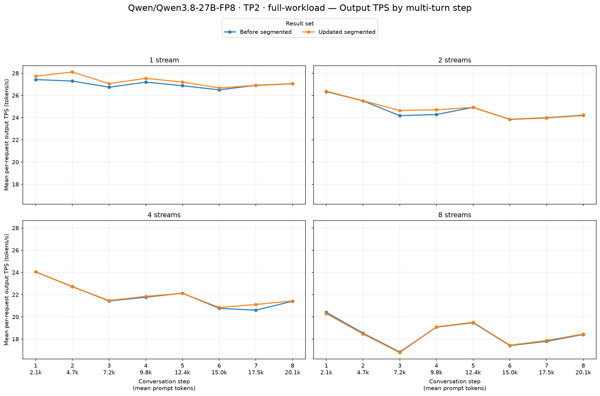
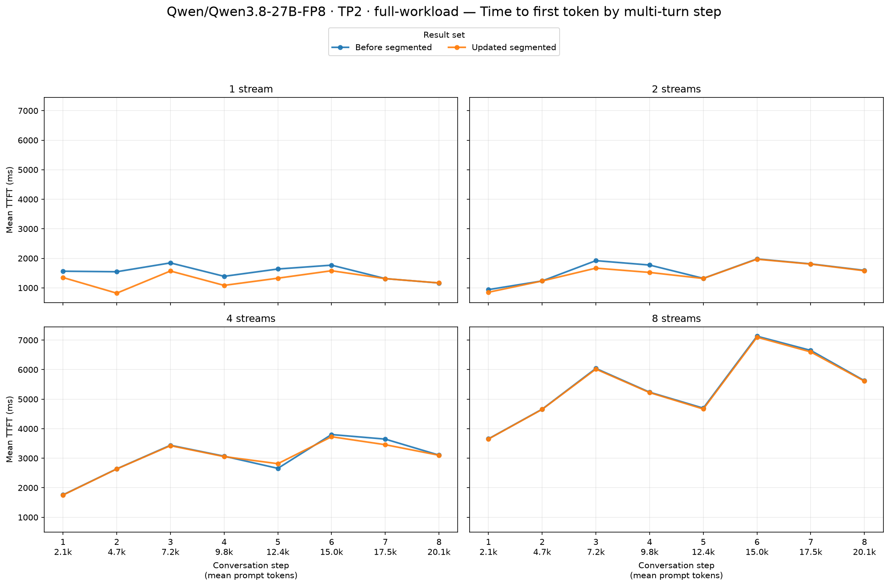
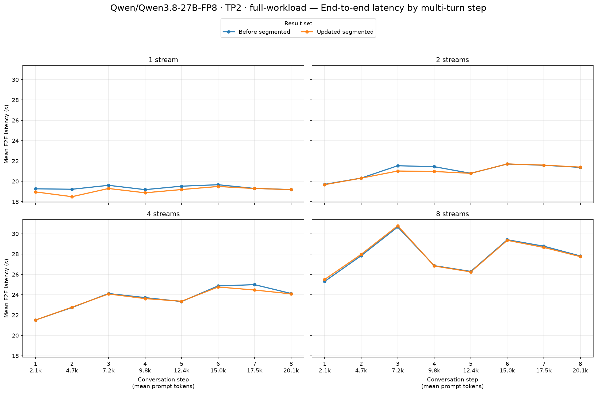

# Qwen/Qwen3.8-27B-FP8 · TP2 · full-workload

Before segmented → Updated segmented. These are end-to-end serving results on two Radeon AI PRO R9700 GPUs (gfx1201), with TP2, BF16 activations, FP8 model weights and explicit FP8 KV cache in every arm.

Model revision: `017b9c7af6b5689d5dd426a76e0bc077eb5ca20a`. Workload: eight turns, 2,048 new synthetic prompt tokens and 512 output tokens per turn; streams 1/2/4/8; seed 20260715; prefix caching enabled. 2 fresh server repetitions per arm. This measures the combined segmented source update: FP8 conversion routing, configuration selection and compressed autotuning.

Segmented startup autotuning: `True`. Main model limits: context 32,768, eight sequences, batched-token limit 8,192, GPU memory utilization 0.90. Backend choice was inspected on both workers; automatic selection uses no attention-backend flag.

Observed baseline backends by rank: `[{'ROCM_SEGMENTED_ATTN': 16}, {'ROCM_SEGMENTED_ATTN': 16}]`. Candidate: `[{'ROCM_SEGMENTED_ATTN': 16}, {'ROCM_SEGMENTED_ATTN': 16}]`.

Model, data definition, streams, request limits and seed match. Every repetition contains 8/16/32/64 successful turn requests and no errored or incomplete requests. The table and charts use means over every successful request, including warmup/cooldown, through the skill's summary and plotting helpers. Positive TPS changes and negative TTFT/E2E changes improve performance.

| Streams | Output tok/s, baseline → candidate | Output tok/s change | Mean TTFT (ms), baseline → candidate | Mean TTFT (ms) change | Mean E2E (s), baseline → candidate | Mean E2E (s) change |
|---:|---:|---:|---:|---:|---:|---:|
| 1 | 27.00 → 27.28 | **+1.0%** | 1,528 → 1,276 | **−16.5%** | 19.37 → 19.10 | **−1.4%** |
| 2 | 24.66 → 24.77 | **+0.4%** | 1,571 → 1,493 | **−5.0%** | 21.05 → 20.93 | **−0.6%** |
| 4 | 21.86 → 21.95 | **+0.4%** | 3,015 → 2,996 | **−0.6%** | 23.68 → 23.58 | **−0.4%** |
| 8 | 18.49 → 18.49 | −0.0% | 5,462 → 5,440 | **−0.4%** | 27.87 → 27.89 | +0.1% |

Output tok/s changes range from -0.0% to +1.0% across the four stream counts.
Mean TTFT (ms) changes range from -16.5% to -0.4% across the four stream counts.
Mean E2E (s) changes range from -1.4% to +0.1% across the four stream counts.

Per-repetition means retain every successful request and expose variation between fresh servers:

| Repeat | Streams | TPS, baseline → candidate | TPS change | TTFT ms, baseline → candidate | TTFT change |
|---:|---:|---:|---:|---:|---:|
| 1 | 1 | 23.13 → 23.73 | **+2.6%** | 2,039 → 1,531 | **-24.9%** |
| 1 | 2 | 21.87 → 22.11 | **+1.1%** | 1,658 → 1,529 | **-7.8%** |
| 1 | 4 | 19.83 → 19.87 | **+0.2%** | 3,022 → 3,035 | +0.4% |
| 1 | 8 | 17.89 → 17.87 | -0.1% | 5,416 → 5,378 | **-0.7%** |
| 2 | 1 | 30.87 → 30.83 | -0.1% | 1,018 → 1,020 | +0.2% |
| 2 | 2 | 27.45 → 27.43 | -0.1% | 1,484 → 1,456 | **-1.9%** |
| 2 | 4 | 23.88 → 24.02 | **+0.6%** | 3,008 → 2,957 | **-1.7%** |
| 2 | 8 | 19.09 → 19.11 | **+0.1%** | 5,508 → 5,502 | **-0.1%** |

All four Qwen runs logged Triton JIT-monitor warnings during measured requests, including both repetitions. Every request remains in the pooled summary, following the skill's all-successful-request rule. Compiler caches persist, but their presence does not establish a fully warmed run. Absolute speed changes between repetitions are substantial; the second repetition is near parity between segmented versions. These small differences do not establish a repeatable optimization gain.

Achieved mean concurrency for each repetition:

| Arm | Repeat | Streams | Mean active requests |
|---|---:|---:|---:|
| Before segmented | 1 | 1 | 1.000 |
| Before segmented | 1 | 2 | 1.999 |
| Before segmented | 1 | 4 | 3.999 |
| Before segmented | 1 | 8 | 7.997 |
| Before segmented | 2 | 1 | 1.000 |
| Before segmented | 2 | 2 | 1.999 |
| Before segmented | 2 | 4 | 3.999 |
| Before segmented | 2 | 8 | 7.997 |
| Updated segmented | 1 | 1 | 1.000 |
| Updated segmented | 1 | 2 | 1.999 |
| Updated segmented | 1 | 4 | 3.999 |
| Updated segmented | 1 | 8 | 7.997 |
| Updated segmented | 2 | 1 | 1.000 |
| Updated segmented | 2 | 2 | 1.999 |
| Updated segmented | 2 | 4 | 3.999 |
| Updated segmented | 2 | 8 | 7.997 |

Startup and tuning are excluded from serving latency. The main comparison has two server repetitions; short exploratory controls have one. Pooled request means are descriptive and do not establish statistical significance. Prefix cache is reset before each complete GuideLLM sweep; the original workload retains cache state between its stream levels.
Compiler caches persist across repetitions. If present, `logs/segmented-serving-2026-10-16/cache-reuse.json` records the reuse of matching model/backend compiler caches and target-attention tuning tables for MTP startup; existing identity and workload guards still validate cache entries.

Raw reports:

- [Before segmented, repetition 1](../../../raw/qwen3.8-27b-fp8/tp2-segmented-before-full-decode-rep1/agent-multiturn-benchmarks.json), [server setup](../../../raw/qwen3.8-27b-fp8/tp2-segmented-before-full-decode-rep1/setup.json), [worker inspection](../../../raw/qwen3.8-27b-fp8/tp2-segmented-before-full-decode-rep1/inspection.json)
- [Before segmented, repetition 2](../../../raw/qwen3.8-27b-fp8/tp2-segmented-before-full-decode-rep2/agent-multiturn-benchmarks.json), [server setup](../../../raw/qwen3.8-27b-fp8/tp2-segmented-before-full-decode-rep2/setup.json), [worker inspection](../../../raw/qwen3.8-27b-fp8/tp2-segmented-before-full-decode-rep2/inspection.json)
- [Updated segmented, repetition 1](../../../raw/qwen3.8-27b-fp8/tp2-segmented-after-full-decode-rep1/agent-multiturn-benchmarks.json), [server setup](../../../raw/qwen3.8-27b-fp8/tp2-segmented-after-full-decode-rep1/setup.json), [worker inspection](../../../raw/qwen3.8-27b-fp8/tp2-segmented-after-full-decode-rep1/inspection.json)
- [Updated segmented, repetition 2](../../../raw/qwen3.8-27b-fp8/tp2-segmented-after-full-decode-rep2/agent-multiturn-benchmarks.json), [server setup](../../../raw/qwen3.8-27b-fp8/tp2-segmented-after-full-decode-rep2/setup.json), [worker inspection](../../../raw/qwen3.8-27b-fp8/tp2-segmented-after-full-decode-rep2/inspection.json)
